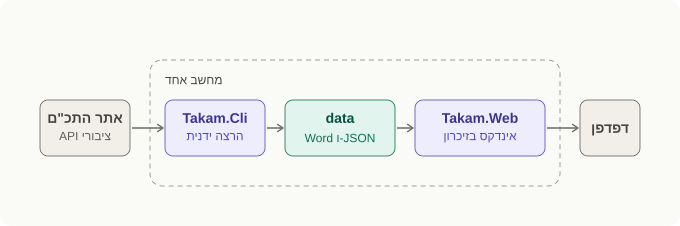

# חיפוש בתוכן הוראות תכ"ם

POC שמחפש **בתוך הטקסט** של הוראות התכ"ם, ברמת סעיף. האתר הרשמי (takam.mof.gov.il) מחפש רק בשם ההוראה ובמילות מפתח שהוזנו ידנית.

כתוב ב‑C#, ‏‎.NET 10. **ה‑POC נכתב בלי חבילות NuGet חיצוניות, בגלל אילוץ בסביבת הפיתוח:** מאגר החבילות שם דורש התחברות. לכן הוא נבנה ורץ בכל מחשב שיש בו ‎.NET SDK, בלי הורדות. בהמשך מתכוונת להשתמש בספריות קוד פתוח מקובלות, למשל לקריאת קובצי Word.

**אתר הדגמה חי (בלי התקנה):** https://chanasm.github.io/takam-demo/ . זו גרסה סטטית שרצה בדפדפן, עם אותו מנוע חיפוש ונתונים אמיתיים מהאתר.

## איך הגעתי לרעיון

התחלתי משיטוט ידני באתר התכ"ם. עברתי בין הלשוניות וניסיתי לחפש, ושמתי לב לשלושה דברים:
- **החיפוש לא מגיע לתוכן.** האתר מחפש רק בשם ההוראה ובמילות מפתח שהוזנו ידנית. התוכן עצמו נמצא בקובצי Word שצריך להוריד.
- **הסכומים לא בהוראה.** תעריפים, למשל 352 ש"ח לשעה למרצה מקבוצה 1, כתובים בהודעה נפרדת שמקושרת להוראה. מי שמחפש סכום צריך לפתוח את שני המסמכים.
- **צריך לדעת מה לחפש.** מי שלא מכיר את שם ההוראה לא יגיע אליה.

הרעיון הראשון שלי היה צ'אט, כי הוא נותן חוויית משתמש נעימה יותר. דמיינתי מנהלת משרד שרוצה לארגן יום עיון עם מרצה וכיבוד, ומקבלת במקום אחד את כל מה שצריך, בלי לפתוח הוראה אחרי הוראה.

אחרי זה חיברתי את Claude לדפדפן וביקשתי ממנו לסייר באתר ולהציע בעיה לפתרון. הוא הציע שני כיוונים: חיפוש בתוכן, והשוואה בין מהדורות של הוראה. כשראיתי מה הוא הציע, הבנתי שהצ'אט והחיפוש יושבים על אותו בסיס: איסוף הקבצים, חילוץ סעיפים מקובצי Word, ואינדוקס. בלי הבסיס הזה גם הצ'אט לא יכול לענות. הצ'אט מוסיף עליו שכבה אחת: מודל שפה שמקבל את הסעיפים שנמצאו ומנסח מהם תשובה עם ציטוטים.

לכן התחלתי מהבסיס, והשארתי את הצ'אט לשלב 2. זה שומר על פרופורציה של POC קטן, וחוסך טוקנים. ההשוואה בין מהדורות לא נתנה לי ערך, כי מה שמעניין משתמש הוא הנוסח התקף היום.

**הבהרה:** בצ'אט לא מאמנים מודל. מחברים מודל מוכן, ובכל שאלה שולחים לו רק את הסעיפים הרלוונטיים שהחיפוש מצא. כך התשובות מבוססות על הטקסט האמיתי, והן מתעדכנות מיד כשהאינדקס מתעדכן, בלי אימון מחדש.

## הבעיה

- התוכן של כל הוראה זמין רק כקובץ Word שצריך להוריד.
- החיפוש באתר לא מגיע לתוכן. למשל, "חילוט ערבות" לא מוצא את סעיף 4.14 בהוראה 7.4.1, אף שזה שם הסעיף.
- הסכומים, למשל 352 ש"ח לשעה למרצה מקבוצה 1, נמצאים בטבלאות בתוך הודעות נפרדות. גם אותם החיפוש באתר לא מוצא.

## מה ה‑POC עושה

1. **איסוף:** מושך מה‑API הציבורי של האתר את המהדורה העדכנית של כל הוראה במדגם, ואת הודעות התעריפים שמקושרות אליה.
2. **חילוץ:** מפרק כל קובץ Word לסעיפים ממוספרים, כמו במקור. טבלאות נשמרות כטקסט, ותוכן העניינים וטבלאות השינויים לא נכנסים.
3. **אינדוקס:** אינדקס חיפוש בזיכרון עם דירוג BM25, שנשמר כקובץ JSON.
4. **חיפוש:** מסך אחד. קודם מוצגים סעיפים שמכילים את כל המילים, ומתחתם סעיפים שמכילים חלק מהן, עד שלושה מכל מסמך. לחיצה על תוצאה פותחת את הסעיף המלא במקום, עם קישור לקובץ המקור.
5. **עדכון:** פקודה שמזהה הוראה חדשה, מהדורה חדשה, ומסמך שפג תוקפו, ומעדכנת באינדקס רק את מה שהשתנה.

**אין בשלב הזה מודל שפה.** הכל רץ מקומית ואינו עולה כסף.

## דוגמה: "חילוט ערבות"

| | מה נמצא |
|---|---|
| האתר הרשמי | הוראה 7.3.3 כולה, בזכות מילת המפתח "חילוט ערבות" |
| ה‑POC, כל המילים | 7.3.3 סעיף 2.5 "חילוט ערבות", 7.4.1 סעיף 4.14 "חילוט ערבות מכרז", 7.3.3 נספח ד |
| ה‑POC, חלק מהמילים | עוד 10 סעיפים, למשל 7.4.1 סעיף 4.13 "חתימה על הסכם התקשרות" |

סעיף 4.14 בהוראה 7.4.1 לא נמצא באתר בכלל, כי מילות המפתח של ההוראה לא מזכירות חילוט.

## המדגם

תרחיש אחד: ארגון יום עיון עם מרצה חיצוני וכיבוד. בנוסף שתי הוראות על מכרזים וערבויות, שמדגימות את ההבדל מהחיפוש באתר.

| הוראה | שם |
|---|---|
| 8.1.2 | הרצאות, שירותי הדרכה, מבחנים ובחינות |
| 2.6.1 | תשלום שכר מרצים |
| 13.4.5 | פעולות הדרכה ואירוח אישים |
| 15.4.3 | רכש שירותי הסעדה |
| 13.13.1 | כיבוד במכרזי כוח אדם ובוועדות |
| 7.4.1 | ניהול ההליך המכרזי |
| 7.3.3 | ערבויות וביטחונות |

ההודעות המקושרות נאספות אוטומטית. בריצה מ‑12/11/2026 נאספו 7 הוראות ו‑6 הודעות, 250 סעיפים בסך הכל. הרשימה נמצאת בקובץ `src/Takam.Core/TakamConfig.cs`.

## הרצה

```bash
dotnet build
```

```bash
dotnet run --project src/Takam.Cli -- rebuild
```

```bash
dotnet run --project src/Takam.Web --urls http://localhost:8765
```

הבנייה מאפס מורידה כ‑13 קבצים מהאתר, ולוקחת כדקה. אחר כך פותחים את http://localhost:8765 בדפדפן.

פקודות נוספות:

```bash
dotnet run --project src/Takam.Cli -- update
```

```bash
dotnet run --project src/Takam.Cli -- search "חילוט ערבות"
```

```bash
dotnet run --project src/Takam.Cli -- parse tests/Takam.Tests/Fixtures/H.7.4.1.docx
```

```bash
dotnet run --project tests/Takam.Tests
```

הפקודה `update` מעדכנת רק את מה שהשתנה באתר. הפקודה `parse` מציגה את הסעיפים שחולצו מקובץ Word אחד, וזה שימושי לדיבוג. האתר מזהה עדכון לאינדקס בלי הפעלה מחדש.

## מבנה הקוד

| קובץ | תפקיד |
|---|---|
| `src/Takam.Core/TakamSiteApi.cs` | קריאות GET ל‑API של האתר |
| `src/Takam.Core/Catalog.cs` | מחליט אילו מסמכים, באיזו מהדורה, צריכים להיות באינדקס |
| `src/Takam.Core/DocxParser.cs` | מפרק קובץ Word לסעיפים, עם ZIP ו‑XML מובנים |
| `src/Takam.Core/IndexStore.cs` | שמירה וטעינה של `data/index.json`, ויומן עדכונים |
| `src/Takam.Core/SearchEngine.cs` | אינדקס, דירוג, קטעי תוצאה, וחיפוש בסגנון האתר להשוואה |
| `src/Takam.Core/SyncService.cs` | עדכון: מוסיף, מעדכן ומסיר. גם בנייה מאפס עוברת כאן |
| `src/Takam.Cli/Program.cs` | שורת הפקודה |
| `src/Takam.Web/` | ASP.NET Core, ארבעה endpoints של JSON, ודף HTML סטטי |
| `tests/Takam.Tests/` | מריץ בדיקות קטן, הבדיקות, וקבצי Word אמיתיים |

## החלטות טכניות

- **בלי חבילות NuGet, כאילוץ ולא כבחירה.** מאגר החבילות בסביבת הפיתוח דורש התחברות, ולכן כתבתי בלי חבילות חיצוניות. קובץ Word הוא ZIP עם קבצי XML, ו‑‎.NET יודע לקרוא את שניהם, ו‑ASP.NET Core הוא חלק מה‑SDK. אפילו הבדיקות רצות במריץ קטן שכתוב בפרויקט. בגרסה הבאה אחליף חלק מזה בקוד פתוח מקובל, כמו ספריית OpenXML לקריאת Word ו‑xUnit לבדיקות.
- **אינדקס בזיכרון ושמירה ב‑JSON, במקום בסיס נתונים.** 250 סעיפים נכנסים בקלות לזיכרון, וקובץ JSON קריא ונוח לדיבוג. הכתיבה אטומית: לקובץ זמני ואז החלפה. לכל 1,100 המסמכים כדאי לעבור ל‑SQLite FTS5.
- **דירוג BM25.** זה הדירוג הסטנדרטי של מנועי חיפוש, וגם של SQLite. כותרת הסעיף מקבלת משקל פי 4 מהגוף.
- **זיהוי סעיפים לפי שם הסגנון ב‑Word ולא לפי המזהה שלו.** המזהה שונה מקובץ לקובץ, השם עקבי.
- **שחזור המספור.** המספור ב‑Word אוטומטי ולא נשמר כטקסט. הקוד סופר כותרות ברמה 1 וסעיפים ברמה 2. פסקה עם מספור מקומי שונה נחשבת לגוף של הסעיף שמעליה. התוצאה נבדקה מול תוכן העניינים של 7.4.1.
- **עברית בחיפוש.** לכל מילה מחפשים גם צורה בלי אות תחילית, ב' ה' ו' וכדומה, וגם שורש בלי סיומת רבים. השורש מתאים רק למילה שהיא השורש ועוד סיומת מוכרת, כמו ים, ות, ה או י. כך "המרצים" מוצא "מרצה", ו"מעונות" מוצא "מעון" אבל לא "מעוניין". גם מילים בטקסט נשמרות פעם נוספת בלי אות תחילית, כך ש"ומעונות" נמצא בחיפוש "מעונות". אותיות סופיות נחשבות כמו רגילות.
- **עדכון בטוח.** מסמך מוחלף רק אחרי שהקובץ החדש הורד וחולץ בהצלחה. אם משהו נכשל, הנוסח הקודם נשאר באינדקס והכשל נרשם ביומן.

## בדיקות

31 בדיקות, בלי רשת. הן רצות על שישה קבצים אמיתיים מהאתר שבתיקייה `tests/Takam.Tests/Fixtures`. אפשר להריץ רק חלק מהן לפי שם, למשל `dotnet run --project tests/Takam.Tests -- Search`.

- **חילוץ:** המספור זהה למקור, תוכן העניינים וקודי השדות לא נכנסים, הטבלאות בהודעה הופכות לסעיפים, והוראה ישנה מ‑2009 נקראת.
- **חיפוש:** "חילוט ערבות" מחזיר גם את 7.3.3 סעיף 2.5 וגם את 7.4.1 סעיף 4.14, והחיפוש בסגנון האתר מוצא רק את 7.3.3. "352" מוצא את טבלת התעריפים. "מעונות" מוצא את טבלת התעריפים ולא את "מעוניין". התוצאות החלקיות לא חוזרות על המלאות, ואין יותר משלוש מאותו מסמך. תווים מיוחדים לא מפילים את החיפוש, והקטע המודגש עובר escaping.
- **עדכון:** הרצה בלי שינויים לא מורידה כלום. מהדורה חדשה מחליפה את הטקסט. מסמך חדש נכנס, ומסמך שיצא מוסר. הורדה שנכשלה משאירה את הנוסח הקודם. האינדקס נטען מחדש מהדיסק בלי שינוי.
- **שירות הווב:** החיפוש מחזיר תוצאות מלאות, חלקיות והשוואה לאתר, ופתיחת סעיף כוללת קישור למקור.

## מגבלות

- **החיפוש מילולי.** "יום עיון" מוצא את "זכות עיון" ולא את ההוראה על הרצאות. זה הפער ששלב 2 נועד לסגור.
- **הטיפול בתחיליות ובסיומות פשוט.** לפעמים הוא מוצא התאמות מקריות. למשל "ערבות" מתקצר ל"ערב".
- **המדגם קטן.** שאלה על נושא אחר לא תמצא כלום, גם אם התשובה קיימת בתכ"ם.
- **טקסט בתוך תמונות לא מחולץ.**
- **תאים ממוזגים אנכית בטבלה** מופיעים רק בשורה הראשונה שלהם.
- **העדכון ידני.** אין תזמון, ומישהו צריך להריץ `update`.

## חשיבה הנדסית והתאמה ל‑Production

### 1. תכנון והחלטות הנדסיות

השיקול המרכזי היה לפתור את הבעיה הכי בסיסית קודם: האתר לא מחפש בתוך התוכן. לכן ה‑POC הוא אינדוקס וחיפוש, בלי מודל שפה, וכל ההחלטות נגזרות מזה.

| שקלתי | בחרתי | למה |
|---|---|---|
| צ'אט עם מודל שפה מול חיפוש בתוכן | חיפוש בתוכן | צ'אט בלי אינדוקס טוב ממציא תשובות. האינדוקס הוא הבסיס לשניהם, והוא עובד בלי עלות. |
| השוואה בין גרסאות של הוראה | ויתרתי | מה שמעניין משתמש הוא הנוסח התקף היום, לא מה השתנה. |
| Elasticsearch או SQLite FTS5 מול אינדקס בזיכרון | אינדקס בזיכרון ו‑JSON | 250 סעיפים לא מצדיקים שרת חיפוש. כל החיפוש מרוכז ב‑`SearchEngine`, כך שהחלפה למנוע אחר נוגעת במקום אחד. |
| כל 1,126 המסמכים מול מדגם | מדגם של 7 הוראות ו‑6 הודעות | מספיק כדי להוכיח את החילוץ והחיפוש על מקרים אמיתיים, כולל הוראה מ‑2009 וטבלאות תעריפים. |
| ספריות לקריאת Word | כתיבה עצמית, זמנית | אילוץ בסביבה: אין גישה למאגר חבילות. בגרסה הבאה עוברים לספריית קוד פתוח, ו‑ZIP של XML הוא הבסיס. |

ויתרתי במודע על: צ'אט, חיפוש סמנטי, הרשאות, תזמון אוטומטי, וכיסוי של כל התכ"ם.

### 2. איכות ותחזוקתיות: המידע מקומי ולא חי

**המגבלה.** החיפוש רץ על עותק מקומי של הקבצים, ולא על האתר עצמו. כשמשרד האוצר מפרסם מהדורה חדשה, המערכת ממשיכה להציג את הנוסח הישן עד שמישהו מריץ `update`. משתמש יכול לקרוא סעיף שכבר לא בתוקף ולפעול לפיו. בתחום של תעריפים ורכש זו טעות שעולה כסף.

**ההשלכות.** ככל שהמדגם גדל, הפער מסוכן יותר, כי אף אחד לא יודע מה השתנה. גם הרחבה למסמכים נוספים דורשת שינוי קוד, כי רשימת ההוראות כתובה ב‑`TakamConfig`.

**השינוי: סנכרון אוטומטי לפי אירועים.**
- **מזהה שינויים מתוזמן.** לאתר אין webhook שמודיע על עדכון, ולכן צריך לבדוק בעצמנו. פונקציית Lambda רצה לפי תזמון, למשל EventBridge כל לילה או כל שעה. היא מושכת את רשימת המסמכים מ‑`/api/Document` ומשווה לכל מסמך את מספר המהדורה ואת `contentVersionId` למה ששמור אצלנו. זו קריאה אחת קלה, בלי להוריד קבצים.
- **אירוע לכל מסמך שהשתנה.** על כל מסמך חדש, מעודכן או שפג תוקפו, ה‑Lambda שולחת הודעה לתור, למשל SQS. השירות שלנו מושך רק את המסמך הזה, מחלץ ומחליף אותו באינדקס. הקוד כבר עושה החלפה של מסמך בודד ב‑`SyncService`, כך שהשינוי הוא בעיקר בהפעלה.
- **תדירות.** עדכונים בתכ"ם מתפרסמים בדרך כלל לכל היותר פעם ביום, ולכן ריצה לילית מספיקה. ריצה כל שעה עולה מעט, כי ברוב הריצות אין שינוי.

**מה קורה כשמהדורה מתפרסמת בזמן שלקוח קורא.** גם עם סנכרון, יש חלון בין הפרסום באתר לסנכרון הבא. כדי שהלקוח לא יפעל על מידע ישן בלי לדעת:
- **שקיפות.** כל סעיף כבר מוצג עם מספר המהדורה, תאריך התחולה וקישור לקובץ המקור, ותאריך הסנכרון האחרון מופיע בתחתית המסך. כדאי להוסיף ליד כל סעיף גם מתי נבדק לאחרונה מול האתר.
- **בדיקת טריות בפתיחת סעיף.** כשמשתמש פותח סעיף, השרת שואל את האתר אם יש מהדורה חדשה יותר של המסמך. זו קריאה קלה ל‑`/api/DocumentVersion`. אם יש, מוצגת הודעה "פורסמה מהדורה חדשה, הנוסח כאן עשוי להיות לא עדכני", והמסמך נכנס מיד לתור הסנכרון.
- **החלפה אטומית.** מסמך מוחלף רק אחרי שהנוסח החדש חולץ בהצלחה, כך שלקוח לא רואה אינדקס חצי מעודכן.

### 3. תהליכי פיתוח ופריסה

**מה יקשה היום על מפתח אחר:**
- **מיקום הנתונים.** אם לא מוגדר `TAKAM_DATA_DIR`, הקוד מחפש את תיקיית הפתרון ושומר לידה. בשרת או בקונטיינר אין תיקיית פתרון, והנתונים ייכתבו לתיקייה הנוכחית ויימחקו עם הקונטיינר.
- **האינדקס הוא קובץ מקומי.** שני מופעים של השרת לא חולקים אותו, וסנכרון שרץ במכונה אחת לא מגיע לאחרת.
- **האינדקס נבנה ידנית.** שרת חדש עולה ריק עד שמישהו מריץ `rebuild`.
- **גרסת ה‑SDK לא נעולה.** הפרויקט דורש ‎.NET 10, ואין `global.json` שאומר את זה.
- **הגדרות בתוך הקוד.** רשימת ההוראות והכתובת של האתר כתובות ב‑`TakamConfig` ולא בקובץ הגדרות.

**השינויים:**
- **Dockerfile** שבונה ומריץ את הבדיקות, עם `global.json` שנועל את גרסת ה‑SDK.
- **כל ההגדרות ממשתני סביבה או מ‑`appsettings`:** תיקיית נתונים, כתובת האתר, רשימת ההוראות או קידומות הפרקים.
- **אחסון משותף לאינדקס,** למשל S3, או מעבר לבסיס נתונים עם חיפוש טקסט. השרת טוען את הגרסה האחרונה בעלייה, ותהליך הסנכרון כותב אליו.
- **אין צורך בפרטי גישה.** ה‑API של האתר ציבורי, כך שאין סודות בקוד. אם יתווסף מודל שפה, המפתח יגיע מ‑Secrets Manager ולא מהריפו.

**איך מוודאים שהפריסה עובדת:**
- **Health check** על `/api/status`, שמחזיר כמה מסמכים וסעיפים באינדקס ומתי היה הסנכרון האחרון. אינדקס ריק נחשב כשל.
- **Smoke test** אחרי כל פריסה: החיפוש "חילוט ערבות" חייב להחזיר את 7.4.1 סעיף 4.14. זה בדיוק הסעיף שהאתר לא מוצא, ולכן הוא מוכיח שגם האינדוקס וגם החיפוש עובדים.

### 4. אבחון וטיפול בתקלות

**התרחיש: האתר משנה את מבנה קובצי ה‑Word.** למשל, תבנית חדשה עם שמות סגנונות אחרים לכותרות ולסעיפים. ההורדה מצליחה והקובץ תקין, אבל המחלץ לא מזהה סעיפים.

**איך זה ייראה.** זו התקלה המסוכנת, כי אין שגיאה. מסמך שהיו בו 40 סעיפים חוזר עם סעיף אחד ארוך, או בלי מספור. החיפוש ממשיך לעבוד, אבל התוצאות מצביעות על "סעיף" שהוא כל ההוראה, והקישור לסעיף מסוים נשבר.

**איך מזהים.**
- **השוואה לגרסה הקודמת.** בכל סנכרון בודקים כמה סעיפים חולצו לעומת המהדורה הקודמת. ירידה חדה, או מסמך שלא נמצא בו אף סעיף ממוספר, היא אזהרה.
- **מדדים והתראה.** הסנכרון כבר כותב יומן עם מה נוסף, עודכן ונכשל. ב‑Production זה עובר ל‑CloudWatch עם התראה על כשלים ועל אזהרות מבנה.

**איך מאבחנים.** הקובץ המקורי נשמר ב‑`data/raw` לפי מספר המהדורה. הפקודה `parse` מריצה את המחלץ על קובץ אחד ומציגה את הסעיפים, כך שאפשר לראות מיד מה השתנה. אחרי התיקון, הקובץ נכנס לתיקיית הבדיקות כ‑fixture, כדי שהתקלה לא תחזור.

**מה הייתי משנה.**
- **לא להחליף נוסח טוב בנוסח שבור.** אם המבנה החדש נראה חשוד, המסמך לא מוחלף אוטומטית, והנוסח הקודם נשאר עם סימון "ממתין לבדיקה". זה ההיגיון של "הורדה שנכשלה משאירה את הנוסח הקודם", מורחב לחילוץ שנכשל בשקט.
- **גיבוי מחילוץ לפי סגנונות.** אם לא זוהו סעיפים, המחלץ מנסה לזהות מספור בתחילת פסקה, כך שהמסמך לפחות נשאר חיפוש ברמת פסקה.

### סקלביליות

| שלב | היקף | מה משתנה |
|---|---|---|
| POC | 13 מסמכים, 250 סעיפים | אינדקס בזיכרון וקובץ JSON |
| כל התכ"ם | כ‑1,100 מסמכים, עשרות אלפי סעיפים | עדיין נכנס בזיכרון. האינדקס עובר ל‑SQLite FTS5 או לבסיס נתונים, כדי לא לטעון ולשמור את הכל בכל עדכון. |
| הרבה משתמשים | כמה מופעים של השרת | אינדקס משותף, או שירות חיפוש מנוהל כמו OpenSearch עם ניתוח עברית. החיפוש עצמו רק קורא, ולכן קל לשכפל אותו. |

**הבנייה הראשונה** של כל התכ"ם היא כ‑1,100 הורדות, עם השהיה של חצי שנייה בין הורדות כדי לא להעמיס על האתר. זה בערך רבע שעה, ורק פעם אחת. אחר כך הסנכרון מוריד רק מה שהשתנה, בדרך כלל מסמכים בודדים ביום. ההורדות יכולות לרוץ במקביל בכמה workers מאותו תור, עם הגבלת קצב משותפת.

### רכיבי AI שאפשר לשלב

הפירוט, כולל איך משפרים ואיך מודדים, נמצא בפרק "בינה מלאכותית" שאחרי הארכיטקטורה.

## בינה מלאכותית

**המצב היום.** אין ב‑POC מודל שפה, ואין אייגנטים. החיפוש הוא אינדקס מילולי עם דירוג BM25, והסנכרון הוא קוד רגיל: משווים מספרי מהדורה ושולחים הודעות. זה זול, צפוי וקל לבדוק.

**אין תוכנית לבנות אייגנטים.** אייגנט הוא מודל שמחליט בעצמו אילו כלים להפעיל ובכמה סבבים. בשאלות על הוראות תכ"ם זה לא מוסיף ערך, ועולה יותר ופחות צפוי. אפילו הצ'אט ייבנה כזרימה קבועה, ובכל שלב בה אפשר לבדוק מה קרה.

### יכולות, לפי סדר

| יכולת | מה היא נותנת | עלות | סיכון |
|---|---|---|---|
| חיפוש סמנטי לצד המילולי | "אירוח" מוצא "כיבוד", ו"יום עיון" מוצא את ההוראה על הרצאות | וקטור לכל סעיף, חד פעמי, ושוב רק כשמסמך משתנה | תוצאות רועשות. לכן משלבים עם BM25 ולא מחליפים אותו |
| מילות מפתח אוטומטיות | באתר שדה התגיות ריק. מודל קטן מציע מילות מפתח לכל הוראה, פעם אחת | קריאה אחת לכל הוראה | הצעה שגויה. מישהו מאשר לפני שמכניסים |
| צ'אט עם ציטוטים | שואלים בשפה חופשית ומקבלים תשובה מנוסחת, עם קישור לכל טענה | קריאה למודל בכל שאלה | המצאה. ראו "בטיחות" |
| סיכום שינויים | כשמהדורה מתחלפת, שני משפטים על מה השתנה | קריאה אחת לכל מהדורה חדשה | סיכום שמחמיץ שינוי. תמיד מציגים גם קישור לנוסח המלא |

### איך הצ'אט עובד

זרימה קבועה בשלושה צעדים:
1. **ניסוח מחדש.** המודל הופך שאלה חופשית לשאילתות חיפוש, למשל "כמה משלמים למרצה" הופך ל"שכר מרצה לשעה".
2. **חיפוש.** הקוד הקיים מחזיר את הסעיפים הטובים ביותר. רק חמשת הראשונים נשלחים למודל.
3. **תשובה.** המודל מנסח תשובה רק מתוך הסעיפים האלה, עם הפניה לכל טענה. אם אין סעיף מתאים, התשובה היא "לא נמצא".

**לא מאמנים מודל.** מחברים מודל מוכן ונותנים לו את הסעיפים בכל שאלה. כשהאינדקס מתעדכן, התשובות מתעדכנות איתו.

### איך משפרים, ואיך יודעים שהשתפר

**מודדים לפני שמשנים.** בונים קובץ קבוע של 30 עד 50 שאלות אמיתיות, ולכל שאלה הסעיף שצריך להימצא. למשל "חילוט ערבות" צריך להחזיר את סעיף 4.14 בהוראה 7.4.1, ו"כמה משלמים למרצה מקבוצה 1" צריך להחזיר את הטבלה בהודעה HOD.8.1.2.1. כבר יש כמה בדיקות כאלה בקוד, והן יהפכו לקובץ אחד שרץ אחרי כל שינוי.

- **בחיפוש.** בודקים אם הסעיף הנכון נמצא בשלוש התוצאות הראשונות. זה לא דורש מודל, ולכן רץ בחינם.
- **בצ'אט.** בודקים שלכל טענה יש ציטוט, ושכשאין מקור התשובה היא "לא נמצא".

**מה משפרים, מהזול ליקר:**
1. **נרמול עברית ומילות מילוי.** כמו התיקון של "מעונות" מול "מעוניין", והתעלמות ממילים כמו "אני רוצה" ו"כמה" בשאילתה. זה כבר קיים, בקוד רגיל. זה זול ונותן הרבה, ובשלב מתקדם מודל יחליף את הרשימה הקצרה.
2. **חיפוש סמנטי לצד BM25.** זה מחליף רשימת מילים נרדפות ידנית, שאין לה סוף. "עוגות לאירוע" ימצא את ההוראות על כיבוד גם בלי אף מילה משותפת.
3. **דירוג מחדש.** מודל קטן מסדר מחדש את 20 התוצאות הראשונות.
4. **הקשר טוב יותר לכל סעיף.** שולחים את הסעיף יחד עם כותרת ההוראה, כדי שהמודל יבין על מה מדובר.

**לומדים מהשימוש.** שומרים שאילתות שלא החזירו תוצאות, בלי פרטים אישיים, ומוסיפים לקובץ השאלות. כפתור "התוצאה עזרה או לא" נותן אות נוסף לאיכות.

### בטיחות ואמינות

- **רק מהמקורות.** התשובה נשענת על הסעיפים שנמצאו ולא על ידע כללי של המודל.
- **כל טענה עם מקור.** קישור לסעיף, עם מספר המהדורה, תאריך התחולה והקובץ המקורי.
- **"לא נמצא" עדיף על ניחוש.** בעניין של כסף ורכש טעות עולה יותר מהיעדר תשובה.
- **פרטים אישיים.** נשלחים למודל רק הסעיפים, שהם מסמכים ציבוריים, והשאלה עצמה. לא שומרים שאלות עם זהות המשתמש.
- **גרסת מודל קבועה.** לפני שמחליפים מודל מריצים את קובץ השאלות ומשווים.
- **הסתייגות במסך.** "המידע אינו מחליף התייעצות עם חשב המשרד" כבר מופיעה בתחתית.

### עלות

החיפוש נשאר בלי מודל. מודל נקרא רק בצ'אט, ובאינדוקס רק כשמסמך משתנה. מתחילים במודל קטן, שומרים תשובות לשאלות חוזרות, ומגבילים טוקנים ו‑rate limit לכל משתמש, כמו שמפורט בפרק הארכיטקטורה.

## ארכיטקטורה: היום ובקנה מידה גדול

### המצב היום

הכל רץ על מחשב אחד. פקודת `update` מורידה קבצים מהאתר לתיקייה מקומית, מחלצת אותם וכותבת קובץ אינדקס אחד. שרת הווב טוען את הקובץ לזיכרון ומחפש בו.



### בקנה מידה גדול

שני מסלולים נפרדים. **מסלול הכתיבה** מזהה שינויים באתר ומעדכן את האינדקס. **מסלול הקריאה** מגיש חיפושים למשתמשים. הם נפגשים רק באחסון.



בתרשים הנקודות הכתומות הן הודעות הסנכרון הלילי, הכחולות הן בקשות חיפוש של משתמשים, הירוקות הן פניות למטמון ולאינדקס, והאדומות הן משתמש שעבר את המגבלה וקיבל 429. בתוך EKS מוצגים שישה pods פעילים, ושלושה מקווקווים שמסמלים pods ש‑HPA מוסיף כשהעומס עולה. בפועל המספר נע בין שלושה לעשרים.

**הקשר בין DynamoDB ל‑OpenSearch.** אין חיבור ישיר ביניהם. ה‑worker מחלץ סעיפים ושומר ב‑S3, ה‑Indexer כותב אותם ל‑OpenSearch, ורק אחרי שהאינדוקס הצליח הוא מעדכן את השורה ב‑DynamoDB, בכתיבה מותנית. אם משהו נכשל באמצע, השורה נשארת עם המהדורה הישנה, והריצה הבאה מעבדת שוב. מזהה הסעיף קבוע, ולכן כתיבה חוזרת ל‑OpenSearch רק דורסת את אותו סעיף.

**הגבלת קצב בשלושה מקומות, והקווים המקווקווים הם בדיקות מול Redis:**
- **מקביליות ה‑workers:** עד חמישה במקביל. ב‑Redis יש מונה של המופעים הפעילים כרגע, והוא מוצג בתרשים כחמש משבצות שנדלקות ונכבות. למונה יש TTL, כדי שמופע שקרס לא ישאיר אותו תקוע. את המקסימום עצמו אפשר לקבוע גם בתור, ואז המונה משמש לתצוגה ולבקרה.
- **בקשות לאתר התכ"ם:** שתי בקשות בשנייה לכל ה‑workers יחד. כל worker לוקח אסימון מ‑Redis לפני כל בקשה, ולכן הקצב נשמר גם כשיש הרבה מופעים.
- **בקשות משתמשים:** מונה נפרד לכל משתמש ב‑Redis, ו‑API Gateway מחזיר 429 למי שעבר את המגבלה. משתמש כבד לא מאט את מי שרק נכנס.

התרשים נמצא בקובץ `docs/architecture-scaled.svg` וניתן לעריכה ישירה.

### איך משווים מהדורות

ה‑Lambda משווה את מה שהאתר אומר עכשיו למה ששמור בטבלה ב‑DynamoDB. בכל ריצה:

1. **רשימת המסמכים:** קריאה אחת ל‑`/api/Document` מחזירה את כל כ‑1,126 המסמכים.
2. **המהדורה הנוכחית:** לכל הוראה, קריאה ל‑`/api/DocumentVersion/{sfid}`. נבחרת המהדורה שאין לה תאריך סיום תוקף, ומשם נלקח `contentVersionId`, המזהה של הקובץ עצמו.
3. **השוואה לטבלה:**

| המצב | המשמעות | הפעולה |
|---|---|---|
| המסמך לא בטבלה | הוראה חדשה | הודעה לתור: הוסף |
| `contentVersionId` שונה | מהדורה חדשה או קובץ שהוחלף | הודעה לתור: עדכן |
| המזהה זהה | אין שינוי | רק עדכון של תאריך הבדיקה |
| בטבלה ולא באתר | פג תוקף או נמחק | הודעה לתור: הסר |

4. **שליחה לתור:** ה‑Lambda עצמה לא מורידה קבצים.

המזהה `contentVersionId` משתנה בכל העלאה של קובץ, גם בתיקון בלי מספר מהדורה חדש. לכן ההשוואה נעשית לפיו. לכל התכ"ם זה כ‑1,100 עד 2,200 קריאות JSON קלות בכל ריצה, כמה דקות בלילה.

### idempotency: למה אותו עדכון יכול להגיע פעמיים

במערכת מבוזרת אי אפשר להבטיח שהודעה תעובד בדיוק פעם אחת. כפילויות קורות במקרים האלה:

1. **ריצות חופפות:** הטבלה מתעדכנת רק אחרי שה‑worker סיים. אם הריצה הבאה מתחילה קודם, היא רואה את אותו פער ושולחת שוב.
2. **ניסיון חוזר של Lambda:** הפונקציה נפלה באמצע, ו‑AWS מריצה אותה שוב מההתחלה.
3. **התזמון:** EventBridge מבטיח הפעלה "לפחות פעם אחת", ולא "בדיוק פעם אחת".
4. **התור:** SQS מוסר הודעה מחדש אם ה‑worker לא סיים בזמן.

לכן המערכת בנויה כך שעיבוד חוזר לא משנה את התוצאה:

- **מזהה קבוע להודעה:** מספר ההוראה ועוד `contentVersionId`. תור FIFO מסנן הודעה זהה.
- **בדיקה לפני עבודה:** ה‑worker מדלג על מהדורה שכבר עובדה.
- **נתיב קבוע ב‑S3:** הקובץ נשמר בנתיב שנגזר מ‑`contentVersionId`, כך שכתיבה שנייה כותבת את אותו קובץ.
- **כתיבה מותנית לטבלה:** הטבלה מתעדכנת רק אם המזהה בה עדיין הישן, כך שהודעה ישנה לא דורסת מהדורה חדשה.
- **רשימה חסרה לא מוחקת:** אם האתר מחזיר רשימה חלקית או ריקה, לא מוחקים כלום. ירידה חדה עוצרת את הריצה ושולחת התראה.

הקוד של היום כבר עושה את זה בקטן. `update` בודק את המהדורה לפני כל הורדה, והבדיקה `Second_run_without_changes_does_nothing` מוודאת שהרצה שנייה לא עושה כלום.

### איפה כל דבר נשמר

| מה | היום | בקנה מידה גדול | למה |
|---|---|---|---|
| קובצי Word | `data/raw` | S3, נתיב לפי הוראה ו‑`contentVersionId` | זול, עמיד, שומר היסטוריה. אפשר לחלץ מחדש בלי להוריד שוב. |
| סעיפים שחולצו | בתוך `index.json` | S3, קובץ JSON לכל מסמך | מקור האמת. ממנו בונים כל אינדקס מחדש. |
| קטלוג מהדורות | בתוך `index.json` | DynamoDB | מצב קטן שנקרא לפי מפתח, עם כתיבה מותנית. |
| אינדקס החיפוש | בזיכרון של השרת | OpenSearch, או בזיכרון של כל pod | ראו בהמשך. |
| מטמון תוצאות ומונים | אין | Redis | שאילתות חוזרות לא מגיעות למנוע החיפוש, והמונים מגבילים קצב ומקביליות. |

**Redis כמטמון ולא כאחסון.**
- **מה הוא לא עושה:** הוא לא מקום לקובצי Word. הזיכרון יקר, ולקבצים ניגשים רק בסנכרון. הוא גם לא מקור אמת, כי הוא מטמון. ל‑RediSearch אין ניתוח עברית.
- **מה הוא כן עושה:** שומר תוצאות במטמון לפי השאילתה המנורמלת ועוד גרסת האינדקס. כשהאינדקס מתחלף, המפתחות הישנים פשוט לא נקראים יותר. הוא גם מגביל קצב לכל לקוח.

**Elasticsearch או OpenSearch.**
- **מה הם נותנים:** BM25, הדגשה בקטעים, סינון לפי פרק ותאריך, ושכפול בין צמתים. הם גם מאפשרים חיפוש וקטורי באותו מקום, וזה הבסיס לחיפוש סמנטי.
- **עברית:** אין ניתוח מובנה. במקום תוסף, מנרמלים את המילים בקוד שלנו לפני האינדוקס ובשאילתה, כך שהלוגיקה הקיימת נשמרת.
- **מתי לעבור:** לכל התכ"ם בלי וקטורים, אינדקס בזיכרון של כל pod זול ומהיר יותר. עוברים ל‑OpenSearch כשמוסיפים חיפוש סמנטי, כשיש הרבה משתמשים, או כשצריך סינונים מורכבים.
- **מה לא משתנה:** מסלול הכתיבה. ה‑Indexer כותב לאינדקס חדש ואז מחליף את ה‑alias, כך שהמשתמשים עוברים לאינדקס החדש בבת אחת.

### הגבלת טוקנים וקצב לכל משתמש

**היום.** החיפוש לא משתמש במודל שפה, ולכן אין בו טוקנים ואין עלות לשאלה. הוא כן משתמש במעבד של השרת, ולכן עדיין צריך להגן עליו.

**בשלב 2, בצ'אט, כל שאלה עולה כסף.** כדי לשלוט בעלות:
- **מעט סעיפים למודל.** שולחים לו רק את חמשת הסעיפים הטובים ביותר שהחיפוש מצא, ולא מסמכים שלמים.
- **תקרה לשאלה ולתשובה.** אורך מקסימלי לשאלה, וגם מספר מקסימלי של טוקנים בתשובה.
- **מכסה יומית לכל משתמש.** אחרי שהמכסה נגמרת, המסך ממשיך לעבוד כחיפוש רגיל. החיפוש נשאר חינמי.
- **מודל קטן קודם.** מתחילים בו, ועוברים לגדול רק אם הוא לא מספיק.
- **מטמון.** שאלה שחוזרת מקבלת את התשובה השמורה, בלי קריאה חדשה למודל.

**rate limit לכל משתמש ולא כללי.** הגבלה כללית לא מתאימה. משתמש אחד שמריץ הרבה חיפושים היה מתקע את כל מי שרק נכנס לאתר. לכן המונה נפרד לכל משתמש או מפתח API, והעומס של אחד לא משפיע על האחרים.

| פעולה | הגבלה התחלתית | למה |
|---|---|---|
| חיפוש | 10 בקשות בשנייה, פרץ של 20 | זול, ומשתמש רגיל לא מגיע לשם |
| שאלה בצ'אט | 5 בדקה, ומכסת טוקנים יומית | כל שאלה עולה כסף |

המספרים הם נקודת פתיחה, ויש לכוון אותם לפי שימוש אמיתי.

- **איך זה עובד.** דלי אסימונים לכל משתמש. כשהדלי ריק, התשובה היא 429 עם `Retry-After`, והמסך מציג הודעה שמבקשת לנסות שוב בעוד רגע.
- **איפה.** ב‑API Gateway, כתוכנית שימוש לכל מפתח. ברמת ה‑pod, מונים ב‑Redis שמשותפים לכל המופעים.
- **הבחנה חשובה.** זו הגבלה על המשתמשים שלנו. הגבלה נפרדת חלה על הבקשות שלנו לאתר התכ"ם בזמן סנכרון.

### למה ככה

- **הפרדה בין כתיבה לקריאה.** אם הסנכרון נכשל, החיפוש ממשיך להגיש את האינדקס התקין האחרון.
- **Lambda לסנכרון.** העבודה היא כמה דקות בלילה, ומשלמים רק על זמן ריצה.
- **pods ב‑EKS לחיפוש.** התעבורה קבועה, והאינדקס או החיבור אליו חיים לאורך זמן. שלושה pods לפחות, בשלושה אזורי זמינות. HPA מוסיף pods לפי העומס.
- **תור בין הזיהוי לעיבוד.** ניסיונות חוזרים, תור כשלים למסמך בעייתי, והגבלת קצב טבעית מול האתר.
- **API Gateway ו‑WAF בכניסה.** אימות, הגבלת קצב לכל לקוח, ומפתחות API ללקוחות חיצוניים.
- **ניטור.** התראה ב‑CloudWatch על כשלים, על הודעות בתור הכשלים, ועל ירידה חדה במספר הסעיפים של מסמך.
